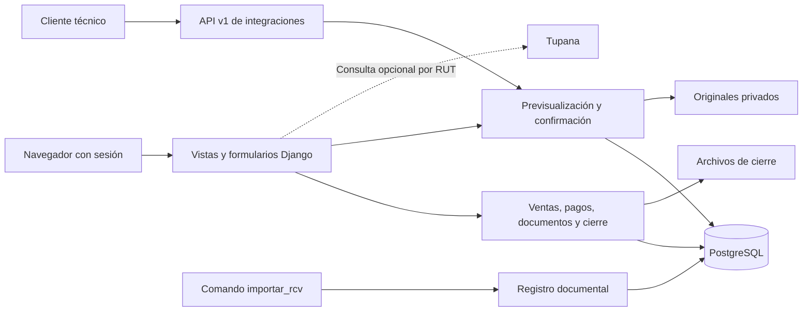

# Arquitectura de Cuadratura

Cuadratura es un backoffice financiero autónomo que organiza la operación de
cada contribuyente y conserva evidencia del cierre mensual. Es un monolito
modular Django con PostgreSQL y plantillas HTML renderizadas en el servidor.
Las integraciones remotas entran por un contrato HTTP versionado. El archivo
de Elemental y el comando del RCV son entradas independientes.

El UUID de ruta determina el contribuyente que valida
[`authorized_organization`](../src/organizations/access.py). Las vistas reciben y
validan la solicitud, los servicios coordinan transacciones y auditoría y las
migraciones materializan las restricciones en PostgreSQL. La API usa sus
propios controles de autenticación y alcance. Cuadratura tiene cuentas,
configuración y base de datos propias. Elemental entrega datos por archivo o
como cliente técnico.

- [Guía de implementación y estructura de carpetas](implementation.md)
- [Modelo de datos, clases persistentes y restricciones](data-model.md)
- [Seguridad, roles y fronteras de confianza](security.md)

## Decisiones del dominio

- UUID para las entidades financieras y el contribuyente. Los modelos auxiliares pueden tener otras claves.
- Los montos se persisten como CLP enteros. El cálculo manual de IVA divide por 1,19 y redondea el neto antes de guardar.
- IVA inicial 19% mediante `calculate_tax_preview`. Para un total bruto afecto se redondea `total / 1,19`; el IVA es la diferencia exacta. Una operación exenta tiene IVA cero.
- Operación, pago, emisión tributaria, registro y conciliación tienen campos temporales distintos.
- La captura crea `Sale`, `SaleLine` y `Payment` en una transacción. La llave de doble envío se guarda como `(organization, origin_system, external_id)` único.
- Una captura manual cuyo pago coincide en organización, fecha de pago, monto y referencia de transferencia con un `Payment` existente marca la nueva venta como `POSSIBLE_DUPLICATE`; no la descarta silenciosamente. Sin referencia no se evalúa la coincidencia.
- Una boleta manual aceptada copia los importes preliminares de la venta, exige DTE habilitado y tipo coherente con la clasificación (39 afecta, 41 exenta), deja la venta `DOCUMENTED` y la marca `RECONCILED` si la suma de pagos iguala el total o `AMOUNT_DIFFERENCE` si no. Esto es carga de un documento conocido, nunca emisión.
- PostgreSQL (triggers de `src/audit/migrations/0002_critical_append_only.py` e `src/imports/migrations/0002_confirmed_imports_append_only.py`) impide actualizar una boleta aceptada y eliminar ventas, pagos, boletas, cierres, auditorías, lotes de importación confirmados y sus filas. Las actualizaciones de ventas, pagos, cierres y lotes no están bloqueadas en base de datos. Las correcciones futuras deberán crear su propio flujo auditado.
- Un período cerrado bloquea nueva captura, carga de boletas manuales e importaciones. En captura manual e importación se comprueba el período de la ruta o lote. La captura de una venta manual exige que su fecha de operación pertenezca al mes de la ruta. La carga PDF comprueba el mes de emisión revisado. Cerrar se rechaza si alguna venta del período (por `operation_date`) no está `RECONCILED`; esto incluye las ventas históricas `MISSING_PAYMENT_DATA`. Reabrir requiere rol, motivo (mínimo 5 caracteres) y evento de auditoría.
- La importación histórica XLSX/CSV es un flujo de dos pasos: el preview persiste lote/filas y archivo privado, pero no registros financieros; el commit bloquea el lote y crea solo filas `NEW` en una transacción. En XLSX se selecciona la hoja cuyo metadato `Periodo` coincide con el período activo.
- Una fila histórica crea `Sale + SaleLine + ElectronicReceipt` aceptada, nunca `Payment`, y usa `MISSING_PAYMENT_DATA` hasta completar datos reales del pago. Tanto CSV como XLSX guardan la venta con `origin_system=CASHBOOK_CSV_V1` y la huella de la fila como `external_id`; el RUT emisor histórico se guarda en `ElectronicReceipt.signer_name`.
- `payments.services.register_historical_receipt_payment` puede agregar después un `Payment` a una boleta aceptada si el monto coincide exactamente, y deja la venta `RECONCILED`. Es idempotente para un pago idéntico y registra `payment.historical_matched`. No tiene vista, comando ni pruebas en el repositorio; se usó para la carga descrita en [finanzas-elementos-import.md](finanzas-elementos-import.md).

## Documentos tributarios del RCV

`documents.TaxDocument` registra facturas (33, 34), notas de débito (56) y de crédito (61) de compras y ventas informadas por el SII en el RCV. Se cargan con el comando `importar_rcv` (`src/documents/rcv.py` lee y valida; `src/documents/rcv_import.py` planifica y aplica). Es un registro documental: no crea `Sale`, `Payment` ni `ElectronicReceipt`, alimenta el panel tributario, queda fuera del XLSX del cierre y un período `CLOSED` bloquea la importación. Clave natural única por contribuyente, dirección, tipo, RUT emisor y folio; un trigger impide modificar o eliminar, salvo completar la referencia de una nota. Detalle en [ADR 0009](adr/0009-documentos-tributarios-rcv.md) y la [guía](importacion-rcv-sii.md).

## Estados

Se modelaron literalmente los estados solicitados para venta, boleta, conciliación y período. `validate_transition` (`src/sales/services.py`) define grafos explícitos, pero hoy solo lo ejercitan las pruebas: los servicios asignan estados directamente. `MonthlyClose` usa en la práctica solo `CLOSED` y `REOPENED`; `OPEN`, `HAS_EXCEPTIONS` y `READY_TO_CLOSE` existen en el modelo sin flujo que los asigne. En el futuro, un timeout desde `SUBMITTING` solo puede pasar a `UNCERTAIN`; desde allí se consulta antes de aceptar o rechazar y no se reserva/emite otro folio.

## Autorización

`PLATFORM_ADMIN` es global en `User`; un superusuario también se considera administrador de plataforma. Los roles de organización (`ORGANIZATION_ADMIN`, `ACCOUNTANT`, `OPERATOR`, `VIEWER`) están en una membresía única por usuario y organización. No existe editor genérico de permisos. Las capacidades viven en `src/organizations/access.py`: lectura para todos los roles; captura (`WRITE_ROLES`) para administrador, contadora/or y operador/a; importación, cierre, reapertura y vista de auditoría (`IMPORT_ROLES`/`CLOSE_ROLES`) para administrador y contadora/or; membresías e invitaciones (`ADMIN_ROLES`) solo para administrador de organización. Crear o editar contribuyentes y el alta controlada de usuarios son exclusivos del administrador de plataforma. La navegación se oculta según rol y el servidor vuelve a comprobar cada acción.

## Límites deliberados

No hay tareas asíncronas, SPA, microservicios ni emisión SII. La única API es la de recepción de lotes (ver [API v1](#api-v1)). Las invitaciones se crean con digest SHA-256 y caducidad, pero el transporte por correo y la pantalla de aceptación son trabajo posterior. El administrador de plataforma dispone además de alta controlada: crea usuario y membresía en una transacción, guarda la contraseña inicial con el hasher de Django y no la registra en auditoría.

## API v1

`integrations.api` expone `/api/v1/` ([ADR 0005](adr/0005-api-v1.md), [guía](api-v1.md)). El documento `cuadratura-operations-v1` se valida en `src/imports/operations_v1.py`. Produce filas normalizadas con la misma forma que Elemental v1, así que la clasificación (`classify_elemental`) y la confirmación (`commit_batch`) son compartidas y ahora reciben el `origin_system` del cliente. El lote guarda en `source_metadata` el origen, el `batch_id` y la huella del contenido; con eso se resuelve la idempotencia sin tablas nuevas. Un origen admite a lo sumo un lote activo (en revisión o confirmado) por período: otro `batch_id` responde 409 `period_already_submitted`. La autenticación, la firma y los límites viven en `src/integrations/security.py` ([ADR 0006](adr/0006-seguridad-api.md)). El autor del lote es el usuario técnico del cliente; quien confirma es una persona con `IMPORT_ROLES`. En la confirmación, `observations` registra «Período de servicio informado por {origen}» cuando viene `service_period`.

## Recepción Elemental v1

`imports.elemental_v1` valida y normaliza el contrato `elemental-cuadratura-v1`; `imports.services` persiste la previsualización y confirma. Esta separación permite reemplazar el archivo por una API sin reimplementar clasificación, idempotencia ni escritura financiera.

Una operación Elemental crea una `Sale` `READY` con `reconciliation_status=RECONCILED`, una `SaleLine`, uno o varios `Payment` y ninguna `ElectronicReceipt`. `Sale` y `Payment` guardan `origin_system=ELEMENTAL` y su identificador externo; `beneficiary.display_name` se copia a `Sale.customer_name`, `service_period` queda como texto en `observations` y `payments[].reference` en `Payment.transfer_reference`. Restricciones únicas de base de datos y bloqueo de la organización serializan confirmaciones concurrentes. Si otra confirmación ya creó la misma operación idéntica, la fila pasa a `ALREADY_IMPORTED` sin error; si cambió, la confirmación completa se revierte.

Como la venta queda `RECONCILED` sin boleta, no aparece en la hoja `Excepciones` ni bloquea el cierre, pero el panel mensual la cuenta como pendiente mientras no esté `DOCUMENTED`. La venta se ubica en el mes de `operation_date`, que puede ser anterior al `selection.period` del archivo. El bloqueo por período cerrado solo evalúa `selection.period`.

Un identificador existente idéntico es no-op. Se comparan fecha de operación, detalle, clasificación, montos y, por pago, identificador, fecha y monto (no la referencia ni el nombre). Contenido distinto, pago externo ya existente sin su operación o coincidencia de `operation_date` y `total_amount` con una venta que no proviene de Elemental es conflicto; entre ventas Elemental solo decide el identificador. La coincidencia con ventas no Elemental se evalúa en la previsualización y no se repite al confirmar. No se sobrescribe una venta documentada y nunca se enlaza por nombre, fecha y monto.

Contrato y ejemplo ficticio: [docs/contracts](contracts/).

### Qué valida realmente el receptor

El receptor no ejecuta el JSON Schema; valida en código (`src/imports/elemental_v1.py`). Diferencias con `elemental-cuadratura-v1.schema.json`:

- Exige `contract_version`, `origin_system=ELEMENTAL`, `batch_id` (texto de hasta 64 caracteres, sin exigir hexadecimal), `generated_at` ISO, `selection.period`, `source_organization.external_id/name`, `expected_taxpayer.tax_id/legal_name` y `operations` (lista de hasta 5000).
- No exige ni valida `selection.timezone`, `selection.criterion`, `concept`, `plan`, `discipline`, `buyer`, `beneficiary.external_id`, `payments[].method`, `pending_records[].entity_type` ni `summary.operations/payments/pending`. `pending_records` y `payments[].reference` son opcionales. Se ignoran campos adicionales (el esquema declara `additionalProperties: false`).
- `tax.net` debe ser mayor que cero (el esquema admite 0); `tax.vat` debe ser cero si es `EXEMPT`; `net + vat = total`; la suma de pagos debe igualar `tax.total`; cada pago debe ser `CONFIRMED`; los identificadores de operación y de pago no se repiten dentro del archivo.
- `summary.total_payments` debe igualar la suma de totales de las operaciones válidas; si difiere, el lote queda bloqueado.
- No comprueba que `payment_date` pertenezca a `selection.period` ni que `operation_date` esté en un período abierto.
- `pending_records` se muestran como filas `IGNORED` («Pendientes informados por Elemental») y no crean registros.
- Idempotencia de archivo: un archivo con el mismo SHA-256 para la misma organización y período devuelve el lote existente. `batch_id` solo se conserva en `ImportBatch.source_metadata` y no participa en la idempotencia.

## Carga de facturas PDF

El flujo web lee hasta cinco páginas de un PDF de 5 MB con Poppler local y sugiere campos para facturas 33 y 34. El formulario permite revisar y completar la extracción. La confirmación lleva metadatos firmados con vigencia de una hora, vinculados al contribuyente, al usuario y al mes de la ruta. Los RUT determinan la dirección. La fecha de emisión revisada determina el mes de registro para facturas y boletas de honorarios, con independencia del mes desde el cual se inició la carga. El cierre se comprueba en el mes de destino. En compras, el período efectivo del RCV puede diferir.

La confirmación reutiliza `TaxDocument` y registra un evento de auditoría. Aplica la misma clave natural del RCV, valida los componentes antes de guardar y vuelve a comprobar el cierre con bloqueo del contribuyente. El PDF se procesa temporalmente. Se conservan los datos revisados y la procedencia con formato `invoice-pdf-v1`, nombre y SHA-256. En compras, el campo de IVA de ese origen contiene el monto del PDF sin clasificación de crédito fiscal. Si una importación posterior del RCV difiere en período, clasificación u otros campos, el importador conserva el documento existente e informa el conflicto.

## Boletas de honorarios PDF

La carga reutiliza el formulario de revisión, los permisos de importación, la extracción local y la confirmación firmada de facturas. Las BHE se guardan en `HonorariumReceipt`, con integridad de bruto menos retención igual a líquido y clave única por contribuyente, emisor y folio. La copia del archivo se elimina tras la lectura. Los datos revisados, el nombre y el hash de procedencia quedan en el registro inmutable que crea la migración `documents.0004_honorarium_receipt`.

El RUT del contribuyente determina si el documento es un ingreso o un egreso. La confirmación vuelve a comprobar contribuyente activo y período abierto bajo bloqueo, y audita la creación sin registrar RUT ni importes en el evento. La carga no crea cobros, pagos ni documentos en el SII.

## Límites observados en la revisión del código

- **Cierre y captura manual.** Las vistas de ventas revisan el cierre antes de
  llamar al servicio. El cierre, la confirmación de lotes y la carga de PDF
  bloquean la fila del contribuyente. La captura manual no comparte ese bloqueo.
  La comprobación de período tampoco vincula la venta de una boleta manual con
  el mes de la ruta. Son límites de la regla de cierre en la implementación
  actual. Fuentes en [vistas de ventas](../src/sales/views.py),
  [servicios de ventas](../src/sales/services.py) y [cierre](../src/reports/services.py).
- **Perímetro del cierre.** El panel muestra facturas, notas y honorarios.
  El XLSX y sus totales se construyen a partir de boletas operativas aceptadas
  por fecha de emisión. Las excepciones se construyen a partir del estado de
  conciliación de ventas por fecha de operación. El PPM y la retención quedan
  como importes registrados en el cierre. [Criterio del libro](monthly-book.md)
- **Integridad y administración.** Parte de la consistencia depende de la
  aplicación, incluido el alcance por organización. El admin de Django
  habilita acceso transversal según los permisos de modelo y las
  restricciones PostgreSQL. [Seguridad](security.md)
