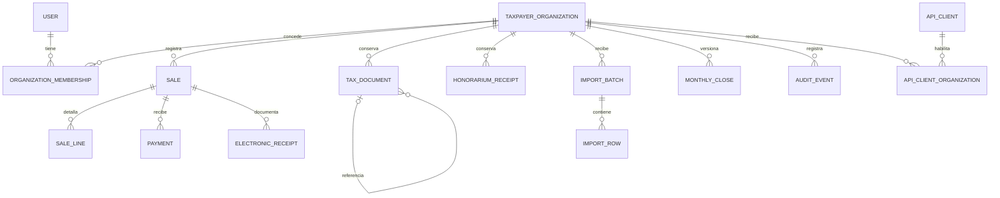

# Modelo de datos y clases persistentes

Esta guía describe los modelos Django y las garantías de las migraciones
PostgreSQL. Los importes operativos y documentales se guardan en pesos chilenos
enteros. El mes se representa con una fecha correspondiente a su primer día
en los campos de período. Las fechas de operación, pago y emisión se conservan
por separado.

El diagrama muestra las relaciones principales. `Payment` y
`ElectronicReceipt` también tienen una FK directa al contribuyente, y
`ImportRow` puede apuntar a una venta, un pago o una boleta según el flujo.
La cardinalidad dibujada corresponde al esquema. Por ejemplo, las FK de
`ElectronicReceipt` permiten varias boletas por venta, aunque la captura
manual opera con sus propias validaciones.

| Modelos y fuente | Qué representan y qué garantiza la base |
|---|---|
| [`User`](../src/accounts/models.py) | Extiende `AbstractUser` con UUID y rol global. Las cuentas humanas y los usuarios técnicos comparten el modelo. |
| [`TaxpayerOrganization`, `OrganizationMembership`, `UserInvitation`](../src/organizations/models.py) | Contribuyente, vínculo de acceso por usuario y organización, e invitación con vigencia. La membresía es única por par. La invitación pendiente es única por organización y correo. `archived_at` y `archived_by` conservan el archivado del contribuyente. |
| [`TaxpayerActivity`, `TaxpayerAddress`](../src/organizations/models.py) | Antecedentes del contribuyente con procedencia. Las actividades son únicas por organización y código. Las direcciones con referencia externa son únicas por organización y referencia. |
| [`Sale`, `SaleLine`](../src/sales/models.py) | Operación económica y su detalle. La venta tiene estados de operación y conciliación independientes. Guarda identidad externa única por organización y origen. La base comprueba neto más IVA igual al total, total positivo e IVA cero para exentas. |
| [`Payment`](../src/payments/models.py) | Entrada asociada a una venta, con fecha, importe positivo y referencia. La clave externa por organización, origen e identificador es única cuando el identificador externo tiene valor. |
| [`ElectronicReceipt`](../src/documents/models.py) | Boleta 39/41 asociada a una venta, con fecha de emisión, montos y estado propios. Los folios informados son únicos por organización y tipo. Los importes se cuadran en la base y el tipo 41 exige IVA cero. |
| [`TaxDocument`](../src/documents/models.py) | Registro de facturas y notas de compras o ventas desde RCV, y facturas revisadas desde PDF. Su identidad es organización, dirección, tipo, RUT emisor y folio. Conserva período tributario, importes, procedencia y un vínculo opcional al documento ajustado. |
| [`HonorariumReceipt`](../src/documents/models.py) | Boleta de honorarios con dirección, emisor/receptor, folio, fecha, bruto, retención y líquido. Única por organización, emisor y folio, y por organización y hash de PDF. El líquido es bruto menos retención. |
| [`ImportBatch`, `ImportRow`](../src/imports/models.py) | Cabecera con organización, período, archivo, hash, estado y metadatos. La misma huella es única por organización y período. Cada fila guarda datos originales y normalizados, clasificación y referencias al resultado. El número de línea es único en el lote. |
| [`MonthlyClose`](../src/reports/models.py) | Versión del cierre por organización y período, con totales, retención, PPM, XLSX, SHA-256, autor y reapertura. La clave incluye el número de versión. |
| [`AuditEvent`](../src/audit/models.py) | Evento por organización y actor opcional. Guarda acción, tipo e identificador del objetivo y metadatos. El objetivo se representa por sus identificadores, sin FK al registro auditado. |
| [`ApiClient`, `ApiClientOrganization`, `ApiAccessFailure`, `ApiRateCounter`, `ApiRequestNonce`](../src/integrations/models.py) | Cliente técnico con usuario uno a uno, origen y credenciales verificables. El vínculo activo define su alcance. Las otras tablas guardan fallos, contadores por ventana y nonces únicos por cliente. |
| [`SiiProfile`, `SiiSubmissionAttempt`](../src/sii/models.py) | Perfil uno a uno con el contribuyente e intento relacionado con una boleta. Son modelos preparados para un flujo de envío futuro. |

## Cuándo interviene PostgreSQL

- [Auditoría y registros críticos](../src/audit/migrations/0002_critical_append_only.py). Bloquea el borrado de eventos, ventas, pagos, boletas y cierres. Bloquea además la actualización de boletas aceptadas. Las actualizaciones de eventos, ventas, pagos y cierres quedan fuera de esos triggers.
- [Lotes confirmados](../src/imports/migrations/0002_confirmed_imports_append_only.py). Bloquea el borrado de cabecera y filas confirmadas. El estado y los vínculos se escriben desde el servicio de confirmación.
- [Registro tributario](../src/documents/migrations/0003_tax_document_guard.py). Bloquea actualizaciones y borrados de `TaxDocument`, salvo completar la referencia de una nota cuando estaba pendiente. [Honorarios](../src/documents/migrations/0004_honorarium_receipt.py) impide toda actualización o borrado de una BHE registrada.
- Varias entidades financieras usan `on_delete=PROTECT` en el ORM. La coherencia entre el contribuyente de una venta y el de sus registros relacionados depende de cómo los construyen los servicios. Una FK por sí sola acredita que el registro apuntado existe.

Las identidades externas de venta y de pago permiten reintentos en los flujos
de importación. La comparación semántica del contenido y la comprobación del
mes abierto se hacen en servicios. La ruta web comprueba permisos antes de
invocarlos. Véanse [arquitectura](architecture.md) y [seguridad](security.md).
